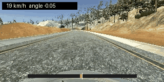
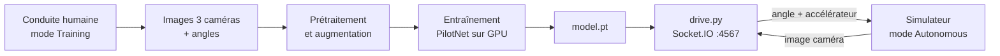
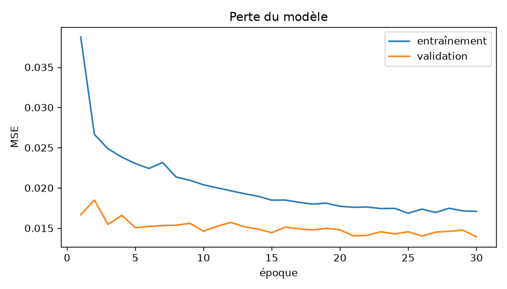

# Self-Driving-Car

Voiture autonome par **behavioral cloning** dans le simulateur Udacity : un réseau
de neurones convolutif apprend à imiter un conducteur humain en associant chaque
image de la caméra frontale à l'angle de braquage choisi par ce conducteur.

L'architecture est celle de NVIDIA (« PilotNet »), décrite dans
[End to End Learning for Self-Driving Cars](https://arxiv.org/abs/1604.07316)
(Bojarski et al., 2016). L'implémentation utilise **PyTorch** et s'entraîne sur
GPU CUDA (testé sur une RTX 5080).



*Vue de la caméra centrale pendant une conduite autonome. La jauge en bas
montre l'angle de braquage prédit par le réseau à chaque image.*

## Principe



1. On conduit à la main dans le simulateur (mode *Training*). Il enregistre les
   images des trois caméras (gauche, centre, droite) et l'angle de braquage.
2. Le réseau apprend la fonction `image -> angle`.
3. En mode *Autonomous*, le simulateur envoie l'image de la caméra centrale à
   `drive.py`, qui renvoie l'angle prédit et la commande d'accélérateur.

## Résultats

Entraînement sur le jeu d'exemple d'Udacity (piste 1, 8 036 instants dont 5 794
gardés après rééquilibrage des lignes droites), 30 époques :

| | Valeur |
| --- | --- |
| Poids du modèle | 252 219 |
| Durée d'une époque (RTX 5080) | environ 4 s |
| MSE de validation | 0.0139 |
| MAE de validation | 0.088 (sur un angle dans `[-1, 1]`) |



La perte de validation reste sous celle d'entraînement : la validation utilise
des images centrales non augmentées, plus faciles que les images transformées
de l'entraînement, et le dropout n'est actif qu'à l'entraînement. Les deux
courbes descendent ensemble, sans signe de surapprentissage.

En mode autonome, la voiture reste centrée sur la piste 1. Le modèle fourni
(`models/model.pt`) permet de lancer `drive.py` sans réentraîner.

### Choix techniques

- **Normalisation dans le modèle** : `drive.py` applique exactement le même
  prétraitement géométrique que l'entraînement, et la normalisation des pixels
  ne peut pas diverger entre les deux.
- **Rééquilibrage** : la moitié des images en ligne droite est écartée, sinon le
  réseau apprend surtout à prédire zéro.
- **Validation sans augmentation** : elle mesure l'erreur dans les conditions
  réelles de conduite (caméra centrale seule).
- **Vitesse adaptative** : la consigne du régulateur PI baisse avec l'angle de
  braquage, et l'angle est lissé entre deux images pour éviter les zigzags à
  haute vitesse.

## Organisation du dépôt

| Chemin | Rôle |
| --- | --- |
| `sdc/config.py` | constantes partagées (taille des images, recadrage, correction d'angle) |
| `sdc/preprocess.py` | prétraitement commun à l'entraînement et à la conduite |
| `sdc/augment.py` | augmentation de données (caméras latérales, miroir, translation, luminosité) |
| `sdc/dataset.py` | lecture de `driving_log.csv` et `Dataset` PyTorch |
| `sdc/model.py` | réseau PilotNet, sauvegarde et rechargement |
| `sdc/control.py` | régulateur de vitesse PI, vitesse adaptative, lissage du braquage |
| `sdc/metrics.py` | score d'autonomie NVIDIA et erreurs de régression |
| `train.py` | entraînement |
| `drive.py` | serveur de conduite autonome pour le simulateur |
| `evaluate.py` | évaluation hors ligne et calcul du score d'autonomie |
| `scripts/download.py` | téléchargement du simulateur et du jeu d'exemple |
| `tests/` | tests unitaires (`pytest`) |

## Installation

Python 3.10 ou plus récent. Sous Windows :

```bash
python -m venv .venv
.venv\Scripts\activate
pip install -r requirements.txt
```

`requirements.txt` installe PyTorch depuis l'index CUDA 12.8, indispensable pour
les cartes RTX 50xx (architecture Blackwell). Pour vérifier que le GPU est bien
utilisé :

```bash
python -c "import torch; print(torch.cuda.is_available(), torch.cuda.get_device_name(0))"
```

Sans GPU, tout fonctionne aussi sur CPU, en plus lent.

### Simulateur et données

Le script suivant télécharge le simulateur Udacity correspondant à votre système
(environ 100 Mo) et le jeu de données d'exemple (environ 320 Mo) :

```bash
python scripts/download.py all        # les deux
python scripts/download.py simulator  # simulateur seul
python scripts/download.py data       # données seules
```

Le simulateur est extrait dans `simulator/` et les données dans
`data/udacity_sample/`. Ces deux dossiers ne sont pas versionnés.

Pour télécharger le simulateur à la main, prendre l'archive de son système et
l'extraire dans `simulator/` :

| Système | Archive |
| --- | --- |
| Windows | [term1-simulator-windows.zip](https://s3-us-west-1.amazonaws.com/udacity-selfdrivingcar/Term1-Sim/term1-simulator-windows.zip) |
| Linux | [term1-simulator-linux.zip](https://s3-us-west-1.amazonaws.com/udacity-selfdrivingcar/Term1-Sim/term1-simulator-linux.zip) |
| macOS | [term1-simulator-mac.zip](https://s3-us-west-1.amazonaws.com/udacity-selfdrivingcar/Term1-Sim/term1-simulator-mac.zip) |

Ces liens viennent du dépôt officiel
[udacity/self-driving-car-sim](https://github.com/udacity/self-driving-car-sim).

### Lancer le simulateur

Sous Windows, lancer `simulator/beta_simulator_windows/beta_simulator.exe`
(double-clic ou depuis un terminal). Sous Linux et macOS, lancer l'exécutable
`beta_simulator` extrait dans `simulator/` (sous Linux, le rendre exécutable
avec `chmod +x` si besoin).

Dans la fenêtre de configuration, cliquer sur **Play!**, choisir la piste avec
les flèches, puis **Training Mode** pour conduire ou **Autonomous Mode** pour
laisser `drive.py` piloter.

## 1. Enregistrer ses propres données

1. Lancer le simulateur, choisir une piste puis **Training Mode**.
2. Cliquer sur l'icône d'enregistrement (ou touche `R`) et choisir un dossier,
   par exemple `data/mes_tours`.
3. Conduire :
   - 2 ou 3 tours au centre de la route, de façon fluide (la souris donne des
     angles plus doux que le clavier) ;
   - 1 tour dans le sens inverse ;
   - des **séquences de récupération** : se placer au bord de la route *sans
     enregistrer*, lancer l'enregistrement, revenir au centre, arrêter.
     Sans elles, le modèle ne sait pas se rattraper quand il dérive.
4. Le dossier contient alors `IMG/` et `driving_log.csv`.

Le jeu d'exemple d'Udacity (piste 1, environ 8 000 instants) suffit pour un
premier modèle.

## 2. Prétraitement et augmentation

Chaque image passe par la même chaîne, à l'entraînement comme en conduite
(`sdc/preprocess.py`) :

- recadrage du ciel (60 pixels en haut) et du capot (25 pixels en bas) ;
- redimensionnement en 66 x 200 pixels, en RGB ;
- normalisation des pixels dans `[-1, 1]`, faite **dans le modèle**.

Sur la piste 1, la voiture roule surtout tout droit et tourne surtout à gauche.
Pour éviter que le modèle ne prédise zéro partout, l'entraînement
(`sdc/augment.py`) :

- tire au hasard la caméra gauche, centrale ou droite, avec une correction de
  +0.2 pour la gauche et -0.2 pour la droite ;
- retourne l'image horizontalement une fois sur deux en inversant l'angle ;
- décale l'image horizontalement en ajustant l'angle de 0.004 par pixel ;
- fait varier la luminosité ;
- ne garde que la moitié des images en ligne droite (`--keep-straight`).

La validation (20 % des données) utilise uniquement la caméra centrale, sans
augmentation.

## 3. Entraîner

```bash
python train.py
python train.py --data-dir data/udacity_sample data/mes_tours --epochs 40
```

Options utiles : `--batch-size`, `--learning-rate`, `--dropout`, `--val-split`,
`--correction`, `--keep-straight`, `--repeat` (passages augmentés par image et
par époque), `--patience` (arrêt anticipé), `--workers`.

Le script produit dans `models/` :

- `model.pt` : le meilleur modèle selon la perte de validation ;
- `history.csv` : pertes et MAE par époque ;
- `loss.png` : courbes d'entraînement et de validation. Une perte de validation
  qui remonte alors que celle d'entraînement baisse indique un surapprentissage.

Modèle : 3 convolutions 5x5 de pas 2 (24, 36, 48 filtres), 2 convolutions 3x3
(64, 64), dropout, couches denses 100, 50, 10 puis 1 sortie. 252 219 poids,
activations ELU, perte MSE, optimiseur Adam.

## 4. Conduire en mode autonome

```bash
python drive.py models/model.pt
```

Puis lancer le simulateur, choisir la piste et cliquer sur **Autonomous Mode**.
Le simulateur se connecte sur le port 4567 et la voiture démarre.

Options :

- `--max-speed` : vitesse visée en ligne droite, en km/h (45 par défaut) ;
- `--min-speed` : vitesse visée dans les virages serrés, en km/h (25 par défaut).
  La consigne baisse progressivement avec l'angle de braquage ;
- `--smoothing` : lissage de l'angle entre deux images (0.3 par défaut, 0 pour
  le désactiver), utile à haute vitesse pour éviter les zigzags ;
- `--record DOSSIER` : enregistre les images reçues et la télémétrie
  (`telemetry.csv`).

Le simulateur Udacity plafonne la voiture à 30 mph, soit environ 48 km/h : une
consigne plus élevée est ramenée à ce maximum. Plus la vitesse est haute, plus
le modèle doit être précis. Si la voiture sort de la route à 45 km/h, baisser
`--max-speed` ou ajouter des données de récupération.

## 5. Évaluer

Le vrai critère est un **tour complet sans sortir de la route**. Pour quantifier,
on reprend le score d'autonomie de NVIDIA : chaque intervention humaine compte
pour 6 secondes.

```
autonomie = (1 - interventions x 6 / durée du tour en secondes) x 100
```

```bash
python evaluate.py autonomy --interventions 1 --duration 75
```

Pour comparer les angles prédits à ceux d'un conducteur sur un enregistrement :

```bash
python evaluate.py offline models/model.pt --data-dir data/mes_tours
```

Une faible erreur hors ligne ne garantit pas une bonne conduite : en boucle
fermée, les petites erreurs s'accumulent et emmènent la voiture dans des
situations absentes des données.

## 6. Itérer

Repérer les endroits où la voiture sort de la route (virage serré, pont, bord
en terre), enregistrer des récupérations à ces endroits précis, puis
réentraîner en ajoutant le nouveau dossier à `--data-dir`.

## Tests

```bash
pytest
ruff check .
```

Les tests couvrent le prétraitement, l'augmentation, la lecture des
enregistrements, l'architecture, la sauvegarde du modèle, la boucle de conduite
et les métriques. Ils tournent sur CPU, sans simulateur.

## Références

- Bojarski et al., *End to End Learning for Self-Driving Cars*, 2016 :
  <https://arxiv.org/abs/1604.07316>
- Simulateur Udacity : <https://github.com/udacity/self-driving-car-sim>
- Projet Udacity d'origine : <https://github.com/udacity/CarND-Behavioral-Cloning-P3>
- Idées d'augmentation : <https://github.com/naokishibuya/car-behavioral-cloning>
